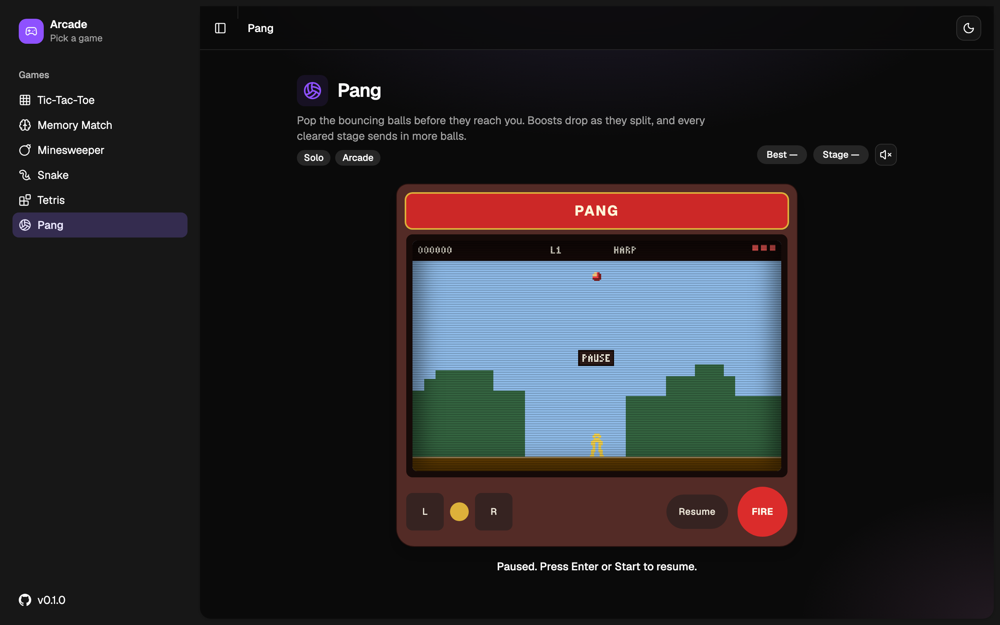
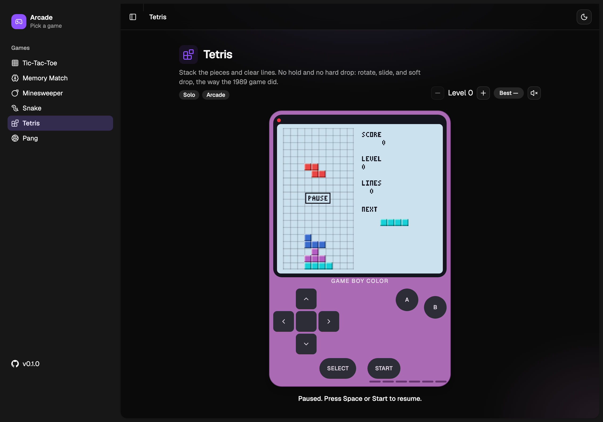
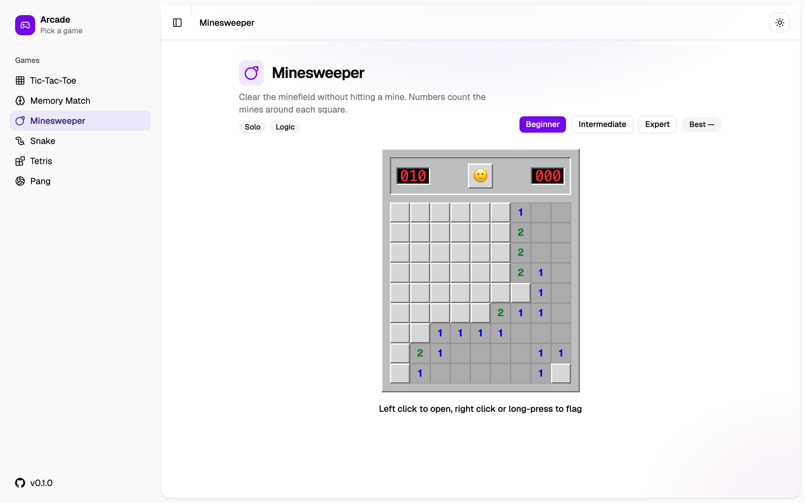
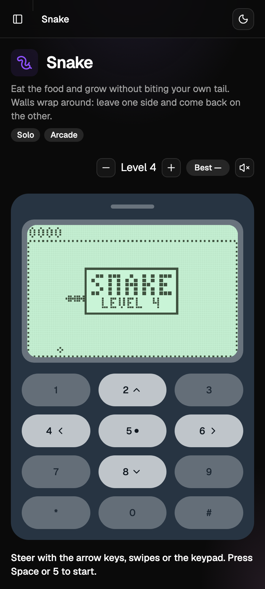
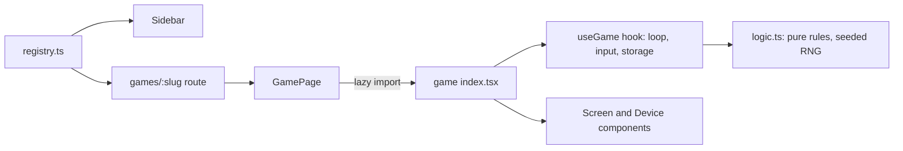

# Arcade

[](https://github.com/mverdaguer/react-games/actions/workflows/ci.yml)

A small single-page app for playing web games in the browser. A sidebar lists the games, and the one you pick opens in the main frame at its own URL.

Live demo: [games.verdegang.workers.dev](https://games.verdegang.workers.dev)


## Games

| Game | URL | How to play |
| --- | --- | --- |
| Tic-Tac-Toe | `/games/tic-tac-toe` | Play the computer on Easy or Hard, or two players on one device. Line up three marks. The score carries across rounds. |
| Memory Match | `/games/memory` | Flip cards on a 4×4 board and find every pair. Moves and time are tracked. |
| Minesweeper | `/games/minesweeper` | Clear every safe square. Left click opens, right click flags. Beginner, Intermediate, and Expert. |
| Snake | `/games/snake` | Eat the food and grow. Walls wrap around. Arrow keys, swipes, or the keypad. The best score is kept for each level. |
| Tetris | `/games/tetris` | Clear lines on a 10×20 well. No hold, no hard drop, one next piece. Arrow keys, the D-pad, or touch. The best score is kept for each start level. |
| Pang | `/games/pang` | Pop the bouncing balls before they reach you. Eight boosts drop as they split. Clearing a stage starts the next one with one more ball. |

`/` is the shelf of games. Any other address shows a not-found page.






## Highlights

- Six games, written as plain TypeScript. There is no game-engine library.
- Each game has its own URL and loads only when you open it.
- Moving between the shelf and a game, or from one game to another, animates with the View Transition API.
- Three test layers: Node unit tests, component tests in a real browser, and Playwright against the production build.
- Sound is synthesized in the browser. The site is static files on Cloudflare Workers.

## Architecture

[`src/games/registry.ts`](src/games/registry.ts) is the list of games. The sidebar and the `games/:slug` route in [`src/App.tsx`](src/App.tsx) both read it, so adding a game is one entry plus a folder. Each entry is a `lazy()` import, and [`TransitionLink`](src/components/page-transition.tsx) starts that import when the link is hovered or focused.

The rules of a game live in `logic.ts`: pure functions, with a seeded random generator where the game needs one. Snake, Tetris, and Pang run the loop, the keyboard, and saved scores from a hook. The smaller games keep that state in the component. Either way, the screen components only draw the current state.

Navigation uses React `<ViewTransition>`. A link tags the change as forward (shelf to a game), back (game to the shelf), or lateral (game to game), and [`GamePage`](src/pages/GamePage.tsx) fades the board in when its `Suspense` boundary finishes loading.



## Design decisions

- **Rules stay pure and seeded.** `logic.ts` takes a state and returns the next one. Randomness comes from a seed, so a test can replay a game step by step in Node without a DOM.
- **Three test layers.** `src/**/*.test.ts` runs in Node. `src/**/*.test.tsx` runs in Vitest Browser Mode, in Chromium. `e2e/*.spec.ts` runs in Playwright against `pnpm build && pnpm preview`, the same files that get deployed.
- **The theme is painted before the first frame.** An inline script in [`index.html`](index.html) reads the saved theme and sets the document class before React loads, so the page does not flash the wrong colors. The Content Security Policy in [`public/_headers`](public/_headers) allows that script by its hash and nothing else inline.
- **Saved data uses versioned keys.** Scores and settings live under keys like `snake:best-scores:v1`. The theme provider still reads the old `arcade-theme` key and moves it to `arcade-theme:v1`.
- **No audio files.** Snake, Tetris, and Pang build their sounds with the Web Audio API when you turn sound on.
- **Static hosting.** [`wrangler.jsonc`](wrangler.jsonc) serves `dist` from Cloudflare Workers and falls back to the app for unknown paths, so a game URL works on refresh. [`public/_headers`](public/_headers) adds the security headers. Deploys run from GitHub Actions after CI passes on main.

## Trade-offs and what's next

- End-to-end tests run in Chromium only.
- Scores and settings are stored per browser in `localStorage`. There is no global leaderboard yet.
- Accessibility is checked by hand. There are no automated checks yet.
- What's next: automated accessibility checks, and a Snake leaderboard on Cloudflare D1.

## Scripts

```bash
pnpm dev         # start the dev server
pnpm build       # typecheck and build for production
pnpm preview     # serve the production build
pnpm lint        # run oxlint
pnpm test        # run unit and component tests once
pnpm test:watch  # run unit and component tests in watch mode
pnpm test:e2e    # run Playwright against the production preview
pnpm screenshots # rebuild the README images
```

## Tests

`src/**/*.test.ts` runs in Node. `src/**/*.test.tsx` runs in Vitest Browser Mode. `e2e/*.spec.ts` runs in Playwright. `pnpm screenshots` is a separate Playwright run and does not run with the end-to-end tests.

Install Chromium once before the end-to-end tests or the screenshots:

```bash
pnpm exec playwright install chromium
```

## Stack

Vite, React, and TypeScript. Tailwind CSS for styling, shadcn/ui for the interface, and React Router for the per-game URLs. Light, dark, and system themes are saved in the browser.

## Adding a game

Games are registered in [`src/games/registry.ts`](src/games/registry.ts). The sidebar and the routes both read that list.

1. Add a component under `src/games/<slug>/index.tsx` and export it as the default. Wrap the board in `GameShell` so the title, description, and toolbar match the other games.
2. Add an entry to `games` with a slug, name, description, icon, tags, and a `lazy` import of that component.

The game is then available at `/games/<slug>`. Run `pnpm screenshots` afterwards so the shelf images stay current.

## Author

Built by Marc Verdaguer, a senior frontend engineer working in TypeScript, React, and Vue.

[GitHub](https://github.com/mverdaguer)
